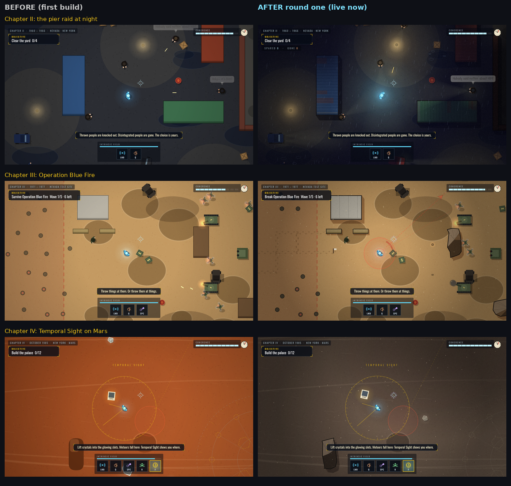

# Handover: how to keep developing this game

> **Current QA continuation (25 October 2026):** `codex/gameplay-qa-polish` starts from `codex/bonus-three` at `ed65bbf`, with a draft PR back into `codex/bonus-three`. Read [the current QA handover](docs/QA-POLISH-HANDOVER.md) for changes, fresh results and remaining limitations. **Do not merge or deploy.** The older Claude branch table and integration workflow below are historical; they are not the base or release instructions for this review.

> Bonus adventures: see [docs/BONUS.md](docs/BONUS.md). The original campaign and separate Story H branch remain untouched.

This file is for whoever picks the project up next, whether a person or an AI coding assistant. Read it first, then `README.md`, then `docs/ROADMAP.md`.

## Where things stand

| Branch | What it is | State |
| --- | --- | --- |
| `claude/dr-manhattan-game` | **The shipped game** (default branch). First build plus iteration 1 (packages A–G). | All 9 test suites pass. `dist/` is up to date. |
| `claude/iter2-integration` | Base for iteration 2: the shipped game plus a small lighting hook (`e.light`). | Start new iteration-2 work from here. |
| `claude/iter2-wip-N` | Iteration 2, package N (fixed-step simulation and balance test gate). | **Unfinished and untested.** |
| `claude/iter2-wip-H` | Iteration 2, package H (story stakes and ending payoffs). | **Unfinished and untested.** |
| `claude/iter2-wip-J` | Iteration 2, package J (enemy depth). | **Unfinished and untested.** |
| `claude/iter1-integration` | History of how iteration 1 was merged. | Done; kept for reference. |

What each WIP branch already has, and what is left (full specs in `docs/ROADMAP.md`):

- **N** (`claude/iter2-wip-N`): fixed 60 Hz simulation step in `Engine.frame`, latched input edges, a seeded gameplay RNG (`DM.rng` in `util.js`), `DM.dev.advance/until/seed/onFrame` in `main.js`, and `tests/flows.mjs` and `tests/smoke.mjs` converted to `DM.dev.advance()`. `tests/playtest.mjs` (a bot that plays and asserts balance bands) is half-written.
  - **Left:** finish the playtest bot and its bands, then the three carry-over balance items (telekinesis can hold enemies forever; energy runs low too often in Chapter III; Veidt dies too fast to Temporal Sight). Then run every suite.
- **H** (`claude/iter2-wip-H`): pier cops, counterfeit presses, the getaway and the river in Chapter II; a Veidt billboard; new interactions during the prologue lockdown; a data-driven ending (`src/data/ending.js`) with tone tiers; memory totals no longer hard-coded; one Veidt line in Chapter III's outro.
  - **Left:** `tests/story.mjs`, screenshots, and a full test run. The code for the spec's items appears to be in, but none of it has been tested yet.
- **J** (`claude/iter2-wip-J`): a large rewrite of `enemies.js` and `projectiles.js` that was cut off mid-way (gangster cover, surrender and morale; new archetypes; machine HP pips and smoke).
  - **Left:** finish and verify those, plus Chapter III crewmen, waves arriving from every side (`deterrent.js`), the two spawn lines in `superman.js`, and a test section in `tests/encounters.mjs`. If this branch is confusing, it is reasonable to restart J from `claude/iter2-integration` using the spec.

Packages I, K and L (iteration 2, wave B) and all of iteration 3 (O–U) have not been started. Their specs are in `docs/ROADMAP.md`.

## How to run and test

```
open index.html                      # play from source (file:// works, no server needed)
node tools/build.mjs                 # rebuild dist/dr-manhattan.html (one self-contained file); never edit dist/ by hand
npm install && npx playwright install chromium   # first time only, for the tests
npm test                             # all 9 suites; or npm run test:<name> for one
```

The suites drive the real game in headless Chromium: smoke, visual, audio, powers, saves, settings, ledger, encounters and flows. Add `?dev` to the URL for developer mode. It unlocks every chapter, `]` skips a stage, and `` ` `` toggles a debug overlay. `DM.dev.start('mars', 2)` jumps to a chapter and stage.

Testing tips learned the hard way:
- **Run suites one at a time on a small machine.** Some checks are timing-based and flake under heavy CPU load. Rerun a failure before concluding it is real. If a check is genuinely flaky, make the test robust, never weaker.
- **Read the real exit code.** `cmd | tail -1` hides failures.
- **Prefer fixed-step drivers in new tests.** `tests/encounters.mjs` shows how; once N lands, use `DM.dev.advance()` instead of wall-clock waits.

## How the code is organised

- Plain JavaScript classic scripts on `window.DM`, with one IIFE per file and `'use strict'`. There is no build step and no dependencies. `index.html` lists the scripts in load order; add a new file there, and `tools/build.mjs` inlines whatever `index.html` lists.
- Everything is drawn and synthesised in code. There are no image or audio assets.
- `README.md` has the project layout and how to add a power, chapter, enemy, character, music, sounds and ambience.

### Conventions every change should follow

These are the contracts between parts of the code.

- **Sounds:** add new ones with `DM.Audio.define('name', { fn(audio, opts) { ... } })` in the file that plays them. `tests/audio.mjs` fails if any `Audio.play('name')` has no recipe.
- **Lights:** a glowing entity defines `light(world, t)`, returning `{ r, i, color, k }` or null.
- **Night readability:** text, markers and telegraphs that must read at night or under Temporal Sight go in `renderEmissive(ctx, world)`. Call it from `render()` only while `!world.lit`.
- **Colour under Temporal Sight:** dangerous things set `e.hazard = true` so they stay in colour.
- **Settings:** add a new option as one entry in `src/core/settings.js` (`DM.SettingsSchema`), then read it with `DM.Save.settings.<id>`.
- **Accessibility:** respect `DM.SettingsSchema.reducedFlashing()`, the SCREEN SHAKE setting, AMBIENT EFFECTS and `textCPS()` / `readTime()`.
- **The spared/gone ledger:** only Disintegrate kills people; throws, blasts and bolts knock them out. Each person counts once, via `enemy:down {lethal}`.
- **Saves:** they are versioned (`src/core/save.js`). If you change the save shape, add a migration and keep `tests/saves.mjs` passing.
- **Writing:** all of it is original. No verbatim Watchmen text.

## A workflow that works

1. Pick **one** package from `docs/ROADMAP.md`. Start a branch from `claude/iter2-integration` (or continue its WIP branch).
2. Read the package's goal, files and items, and the cross-package contracts at the top of the iteration-2 section. Check each claim against the current code first, because line numbers in the specs are from the first build.
3. Make small commits as you go.
4. Before merging:
   - Every suite passes, plus a new test for the package's acceptance criteria.
   - Take screenshots and look at them (night maps and Temporal Sight especially).
   - `node --check` passes on every touched file.
5. Merge into `claude/iter2-integration`, run all suites again, rebuild `dist/`, and update the README's feature notes.
6. When a whole wave is merged and green, fast-forward `claude/dr-manhattan-game` to it.

Expect the most visible gains in the iteration-2 content packages: H (story), I (Chapter I, Mars and Karnak set pieces), J (enemies), K (UI) and L (effects). N and parts of iteration 1 mostly improve feel, fairness and reliability, which doesn't show in screenshots.

## Before and after iteration 1


