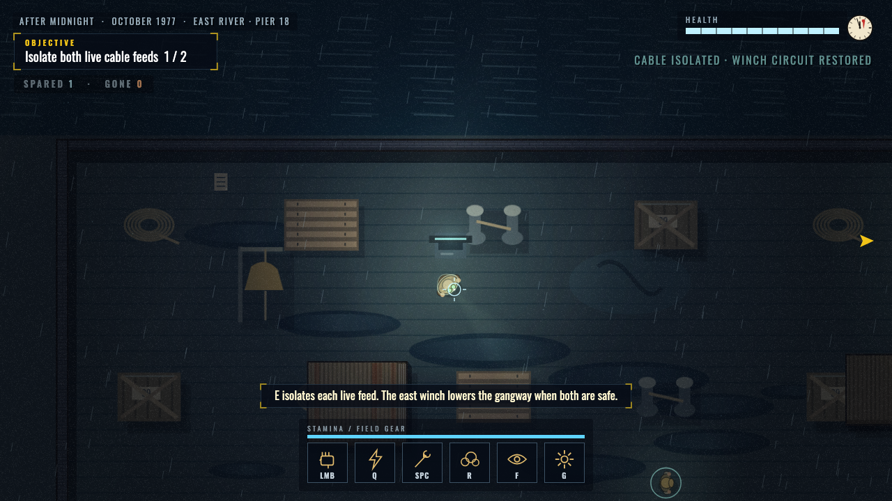

# Undertow breaker guidance fix

Peter reported that the west breaker did not respond at **1 / 2** isolated feeds.
The west breaker was already off, so E correctly had no action there. The actual
bug was the fixed WEST BREAKER objective marker, which kept directing players
back to that disabled terminal instead of the remaining live east feed.

The stage now selects the remaining live breaker when its power flags change.
West-first moves the marker east; east-first keeps it west. Either order reaches
the existing cargo-winch stage. Single-feed carried progress selects the correct
marker immediately. The change uses the existing stage waiter and adds no
per-frame entity scan, rendering change, delay or save-format change.

## Verification

- New marker regression failed against the previous runtime with exit **1**.
- After the fix: **99 case checks per build**, including 24 new checks covering
  all three heroes, both orders, carried single-feed state and winch progression.
- **22 source + 22 standalone suites passed**, run sequentially; all exits **0**.
- Real-input Nite Owl standalone journey: normal menus, vulnerable Normal play,
  west-to-east guidance and actual completion with all four workers rescued.
- All 20 previously protected campaign, music and engine file hashes match.
- No thresholds/assertions weakened. No merges, deploys or protected-branch push.

The [machine-readable report](undertow-breaker-results.json) includes each suite's
final line/exit, source/build hashes and the natural journey trace. Prior review
limitations remain in [the rules-v2 report](PALACE-REVIEW-RESPONSE.md).

## Live capture

Captured after at least ten active seconds through ordinary play, after actually
isolating west. The marker now points to EAST BREAKER while the objective is 1 / 2.

## Every suite final line and exit

| Build | Suite | Exit | Final line |
| --- | --- | ---: | --- |
| source | smoke | 0 | Smoke test passed. |
| source | visual | 0 | All atmosphere checks passed. |
| source | audio | 0 | All audio checks passed. |
| source | powers | 0 | All mechanics checks passed. |
| source | saves | 0 | All save & robustness checks passed. |
| source | settings | 0 | All settings & accessibility checks passed. |
| source | ledger | 0 | All ledger & combat-feel checks passed. |
| source | encounters | 0 | All encounter checks passed. |
| source | flows | 0 | All story flow checks passed. |
| source | bonus | 0 | BONUS ACCEPTANCE PASSED: 42 checks (normal file loading). |
| source | ninth-minute | 0 | NINTH MINUTE PASSED: 75 checks (normal file loading). |
| source | long-summer | 0 | LONG SUMMER PASSED: 82 checks (normal file loading). |
| source | vigilantes | 0 | VIGILANTES PASSED: 43 checks (chromium, index.html). |
| source | after-midnight-cases | 0 | AFTER MIDNIGHT CASES PASSED: 99 checks (chromium, index.html). |
| source | after-midnight-modes | 0 | AFTER MIDNIGHT MODES PASSED: 45 checks (index.html). |
| source | after-midnight-integration | 0 | AFTER MIDNIGHT INTEGRATION PASSED: 36 checks (index.html). |
| source | surveyor-gear | 0 | SURVEYOR GEAR PASSED: 5 checks (index.html). |
| source | glass-palace | 0 | GLASS PALACE PASSED: 76 checks (chromium, index.html). |
| source | glass-palace-navigation | 0 | GLASS PALACE NAVIGATION PASSED: 47 checks (index.html). |
| source | glass-palace-backup | 0 | GLASS PALACE BACKUP PASSED: 46 checks (chromium, index.html). |
| source | glass-palace-tracking | 0 | GLASS PALACE TRACKING PASSED: 86 checks (chromium, index.html). |
| source | glass-palace-optionality | 0 | GLASS PALACE OPTIONALITY PASSED: 143 checks; 36 misses + 36 earns (chromium, index.html). |
| standalone | smoke | 0 | Smoke test passed. |
| standalone | visual | 0 | All atmosphere checks passed. |
| standalone | audio | 0 | All audio checks passed. |
| standalone | powers | 0 | All mechanics checks passed. |
| standalone | saves | 0 | All save & robustness checks passed. |
| standalone | settings | 0 | All settings & accessibility checks passed. |
| standalone | ledger | 0 | All ledger & combat-feel checks passed. |
| standalone | encounters | 0 | All encounter checks passed. |
| standalone | flows | 0 | All story flow checks passed. |
| standalone | bonus | 0 | BONUS ACCEPTANCE PASSED: 42 checks (normal file loading). |
| standalone | ninth-minute | 0 | NINTH MINUTE PASSED: 75 checks (normal file loading). |
| standalone | long-summer | 0 | LONG SUMMER PASSED: 82 checks (normal file loading). |
| standalone | vigilantes | 0 | VIGILANTES PASSED: 43 checks (chromium, dist/dr-manhattan.html). |
| standalone | after-midnight-cases | 0 | AFTER MIDNIGHT CASES PASSED: 99 checks (chromium, dist/dr-manhattan.html). |
| standalone | after-midnight-modes | 0 | AFTER MIDNIGHT MODES PASSED: 45 checks (dist/dr-manhattan.html). |
| standalone | after-midnight-integration | 0 | AFTER MIDNIGHT INTEGRATION PASSED: 36 checks (dist/dr-manhattan.html). |
| standalone | surveyor-gear | 0 | SURVEYOR GEAR PASSED: 5 checks (dist/dr-manhattan.html). |
| standalone | glass-palace | 0 | GLASS PALACE PASSED: 76 checks (chromium, dist/dr-manhattan.html). |
| standalone | glass-palace-navigation | 0 | GLASS PALACE NAVIGATION PASSED: 47 checks (dist/dr-manhattan.html). |
| standalone | glass-palace-backup | 0 | GLASS PALACE BACKUP PASSED: 46 checks (chromium, dist/dr-manhattan.html). |
| standalone | glass-palace-tracking | 0 | GLASS PALACE TRACKING PASSED: 86 checks (chromium, dist/dr-manhattan.html). |
| standalone | glass-palace-optionality | 0 | GLASS PALACE OPTIONALITY PASSED: 143 checks; 36 misses + 36 earns (chromium, dist/dr-manhattan.html). |

Natural standalone journey, exit **0**: `UNDERTOW LIVE PASSED: 18 checks; lowest observed health 104.90 (niteowl, dist/dr-manhattan.html).`
